  
  

<picture>
  <source media="(prefers-color-scheme: dark)" srcset="./profile/snake-dark.svg" />
  
</picture>

Refreshed daily with GitHub Actions · Built with <a href="https://github.com/Platane/snk">snk</a> and <a href="https://github.com/stats-organization/github-readme-stats-action">GitHub Readme Stats Action</a>

Hi, I'm **MichaelCaoo** from **Nanjing University**.
- My publications are available on [Google Scholar](https://scholar.google.com/citations?user=p-Rt0KUAAAAJ&hl=zh-CN).
- More of my work is available on [GitHub](https://github.com/MichaelCao0).

### 📊 GitHub Stats

  <picture>
    <source media="(prefers-color-scheme: dark)" srcset="./profile/stats-dark.svg" />
    
  </picture>

### 📚 Research

<!-- RESEARCH:START -->
  

Google Scholar · Updated 2026-10-19 UTC · Refreshed daily

#### Conference papers

**T2AV-Compass: Towards Unified Evaluation for Text-to-Audio-Video Generation** 
**ICML 2026 · CVPR 2026 VGBE Workshop Oral** 
[Paper](https://proceedings.mlr.press/v306/cao26v.html) · [Code](https://github.com/NJU-LINK/T2AV-Compass) · [Project](https://nju-link.github.io/T2AV-Compass/) · 

**OmniVideoBench: Towards Audio-Visual Understanding Evaluation for Omni MLLMs** 
**ICLR 2026** 
[Paper](https://arxiv.org/abs/2510.10689) · [Code](https://github.com/NJU-LINK/OmniVideoBench) · [Project](https://omnivideobench.github.io/omnivideobench_home/) · 

**SafeDialBench: A Fine-Grained Safety Evaluation Benchmark for Large Language Models in Multi-Turn Dialogues with Diverse Jailbreak Attacks** 
**ICLR 2026** 
[Paper](https://arxiv.org/abs/2502.11090) · [Code](https://github.com/drivetosouth/SafeDialBench-Dataset) · [Project](https://safedialbench.github.io/) · 

**Frontier-Eng: Benchmarking Self-Evolving Agents on Real-World Engineering Tasks with Generative Optimization** 
**NeurIPS 2026** 
[Paper](https://arxiv.org/abs/2604.12290) · [Code](https://github.com/Einsia/Frontier-Engineering) · [Project](https://lab.einsia.ai/frontier-eng/) · 

**OmniHalluc-L: Counterfactual Benchmarking and Modality-Perturbation Reliability Calibration for Long-Form Omni Hallucination** 
**EMNLP 2026** 
[Paper](https://arxiv.org/abs/2606.03614) · [Code (MPRC)](https://github.com/ZexDong/omnihallucL-mprc) · 

**AVSCap: Orchestrating Audio-Visual Synergy for Omni-modal Video Captioning** 
**EMNLP 2026 Main** 
[Paper](https://arxiv.org/abs/2607.12820) · [Code](https://github.com/NJU-LINK/AVSCap) · [Project](https://nju-link.github.io/AVSCap/) · 

#### Preprints

**The Latent Space: Foundation, Evolution, Mechanism, Ability, and Outlook** 
**arXiv 2026** 
[Paper](https://arxiv.org/abs/2604.02029) · [Collection](https://github.com/xlyu0106/Awesome-Latent-Space) · 

**RoboRouter: Training-Free Policy Routing for Robotic Manipulation** 
**arXiv 2026** 
[Paper](https://arxiv.org/abs/2603.07892) · 

**Stabilizing Language Models under Continual Learning via Condition-Anchored Distillation** 
**arXiv 2026** 
[Paper](https://arxiv.org/abs/2610.06940) · 
<!-- RESEARCH:END -->

### 🛠 Open Source

Selected merged contributions:

| Project | Contribution |
| :--- | :--- |
| **[vLLM-Omni](https://github.com/vllm-project/vllm-omni)** | Preserved static KV staging inputs for CUDA Graph capture in AR-Diffusion. [#7921](https://github.com/vllm-project/vllm-omni/pull/7921) |
| **[RL-Kernel](https://github.com/RL-Align/RL-Kernel)** | Fixed indexed writes into noncontiguous output views and isolated inactive logits before normalization. [#454](https://github.com/RL-Align/RL-Kernel/pull/454) · [#465](https://github.com/RL-Align/RL-Kernel/pull/465) |
| **[Libra](https://github.com/libra-tools/libra)** | Contributed an operation history layer with CLI integration and validation coverage. [#407](https://github.com/libra-tools/libra/pull/407) |
| **[T2AV-Compass](https://github.com/NJU-LINK/T2AV-Compass)** | Added a reproducible objective evaluation workflow and streamlined evaluation environments. [#6](https://github.com/NJU-LINK/T2AV-Compass/pull/6) · [#12](https://github.com/NJU-LINK/T2AV-Compass/pull/12) |

### ⚡ Recent Activity

My latest public pull requests and issues, ordered by last update.

<!-- ACTIVITY:START -->
**Pull requests** · 26 public PRs authored

| Status | Repository · Title | Updated |
| :--- | :--- | :--- |
| 🟣 Merged | **RL-Align/RL-Kernel** · [fix\(ratio\_kl\): isolate inactive logits before normalization #465](https://github.com/RL-Align/RL-Kernel/pull/465) | 2026-10-17 |
| 🟢 Open | **RL-Align/RL-Kernel** · [fix\(grpo\): stabilize group variance for offset rewards #455](https://github.com/RL-Align/RL-Kernel/pull/455) | 2026-10-10 |
| 🟢 Open | **RL-Align/RL-Kernel** · [fix\(sampling\): preserve per-row parameters in active chunks #464](https://github.com/RL-Align/RL-Kernel/pull/464) | 2026-10-10 |
| 🟣 Merged | **RL-Align/RL-Kernel** · [fix\(logp\): write indexed results into noncontiguous output views #454](https://github.com/RL-Align/RL-Kernel/pull/454) | 2026-10-02 |
| ⚪ Closed | **vllm-project/vllm-omni** · [\[Core\] Allocate AR-Diffusion KV blocks for reachable session demand #8167](https://github.com/vllm-project/vllm-omni/pull/8167) | 2026-09-26 |

**Issues** · 14 public issues authored

| Status | Repository · Title | Updated |
| :--- | :--- | :--- |
| 🟢 Open | **NoizAI/HelixWorld** · [Wechat QR Code expired #17](https://github.com/NoizAI/HelixWorld/issues/17) | 2026-10-19 |
| 🟢 Open | **zhengchen1999/Grounding-IQA** · [权重和推理代码开源 #5](https://github.com/zhengchen1999/Grounding-IQA/issues/5) | 2026-10-14 |
| 🟢 Open | **vivoCameraResearch/StereoBind** · [Inquiry regarding the estimated release timeline #1](https://github.com/vivoCameraResearch/StereoBind/issues/1) | 2026-10-14 |
| ⚪ Closed | **libra-tools/libra** · [Track operation history data model, CLI integration, and validation #408](https://github.com/libra-tools/libra/issues/408) | 2026-09-23 |
| ⚪ Closed | **gitmono-dev/mega** · [\[libra\] 为 init 命令添加 --separate\_git\_dir=&lt;libra-dir&gt; 参数 #1115](https://github.com/gitmono-dev/mega/issues/1115) | 2026-07-01 |
<!-- ACTIVITY:END -->

[All pull requests](https://github.com/pulls?q=is%3Apr+author%3AMichaelCao0+sort%3Aupdated-desc) · [All issues](https://github.com/issues?q=is%3Aissue+author%3AMichaelCao0+sort%3Aupdated-desc)
