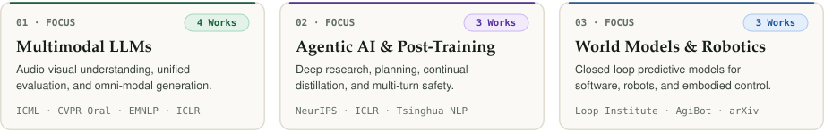

<a href="https://michaelcao0.github.io/">
  <picture>
    <source media="(prefers-color-scheme: dark)" srcset="./profile/hero-dark.svg" />
    
  </picture>
</a>

  
  
  
  
  

---

### 🧭 Research Focus

I am an undergraduate student in **Computer Science and Technology at Nanjing University**, working on multimodal learning, evaluation, post-training, and the systems that make AI research reliable.

  <picture>
    <source media="(prefers-color-scheme: dark)" srcset="./profile/pillars-dark.svg" />
    
  </picture>

---

### 📚 Selected Publications

<!-- RESEARCH:START -->
   · Google Scholar · Updated 2026-11-23 UTC · Refreshed daily

#### Accepted Conference Papers (6)

| Publication | Venue | Cited |
| :--- | :--- | ---: |
| **T2AV-Compass**: Towards Unified Evaluation for Text-to-Audio-Video Generation ★ Representative · Co-First* · MLLMs · <a href="https://proceedings.mlr.press/v306/cao26v.html">Paper</a> · <a href="https://github.com/NJU-LINK/T2AV-Compass">Code</a> · <a href="https://nju-link.github.io/T2AV-Compass/">Project</a> |   |  |
| **AVSCap**: Orchestrating Audio-Visual Synergy for Omni-modal Video Captioning MLLMs · <a href="https://arxiv.org/abs/2607.12820">Paper</a> · <a href="https://github.com/NJU-LINK/AVSCap">Code</a> · <a href="https://nju-link.github.io/AVSCap/">Project</a> |  |  |
| **OmniHalluc-L**: Counterfactual Benchmarking and Modality-Perturbation Reliability Calibration for Long-Form Omni Hallucination MLLMs · <a href="https://arxiv.org/abs/2606.03614">Paper</a> · <a href="https://github.com/ZexDong/omnihallucL-mprc">Code (MPRC)</a> |  |  |
| **Frontier-Eng**: Benchmarking Self-Evolving Agents on Real-World Engineering Tasks with Generative Optimization Agentic AI · <a href="https://arxiv.org/abs/2604.12290">Paper</a> · <a href="https://github.com/Einsia/Frontier-Engineering">Code</a> · <a href="https://lab.einsia.ai/frontier-eng/">Project</a> |  |  |
| **OmniVideoBench**: Towards Audio-Visual Understanding Evaluation for Omni MLLMs MLLMs · <a href="https://arxiv.org/abs/2510.10689">Paper</a> · <a href="https://github.com/NJU-LINK/OmniVideoBench">Code</a> · <a href="https://omnivideobench.github.io/omnivideobench_home/">Project</a> |  |  |
| **SafeDialBench**: A Fine-Grained Safety Evaluation Benchmark for Large Language Models in Multi-Turn Dialogues with Diverse Jailbreak Attacks Agentic AI · <a href="https://arxiv.org/abs/2502.11090">Paper</a> · <a href="https://github.com/drivetosouth/SafeDialBench-Dataset">Code</a> · <a href="https://safedialbench.github.io/">Project</a> |  |  |

#### Preprints & Surveys (4)

| Publication | Venue | Cited |
| :--- | :--- | ---: |
| **From Prediction to Control**: A Survey of Closed-Loop World Models for Robot Learning World Models · <a href="https://www.preprints.org/manuscript/202611.0078">Paper</a> · <a href="https://github.com/aitofound/awesome-robot-world-model">Code</a> |  |  |
| **Stabilizing Language Models under Continual Learning via Condition-Anchored Distillation** 2nd Author · Agentic AI · <a href="https://arxiv.org/abs/2610.06940">Paper</a> |  |  |
| **The Latent Space**: Foundation, Evolution, Mechanism, Ability, and Outlook World Models · <a href="https://arxiv.org/abs/2604.02029">Paper</a> · <a href="https://github.com/xlyu0106/Awesome-Latent-Space">Collection</a> |  |  |
| **RoboRouter**: Training-Free Policy Routing for Robotic Manipulation 2nd Author · World Models · <a href="https://arxiv.org/abs/2603.07892">Paper</a> |  |  |
<!-- RESEARCH:END -->

---

### 🛠️ Open-Source Systems Contributions

| Upstream Project | Merged Contribution | PRs |
| :--- | :--- | :--- |
| **[vLLM-Omni](https://github.com/vllm-project/vllm-omni)** | Preserved static KV staging inputs for CUDA Graph capture in AR-Diffusion | [#7921](https://github.com/vllm-project/vllm-omni/pull/7921) |
| **[RL-Kernel](https://github.com/RL-Align/RL-Kernel)** | Fixed indexed writes into noncontiguous output views and isolated inactive logits before normalization | [#454](https://github.com/RL-Align/RL-Kernel/pull/454) · [#465](https://github.com/RL-Align/RL-Kernel/pull/465) |
| **[Libra](https://github.com/libra-tools/libra)** | Contributed an operation history layer with CLI integration and validation coverage | [#407](https://github.com/libra-tools/libra/pull/407) |

---

### 📊 GitHub Telemetry & Activity

  <picture>
    <source media="(prefers-color-scheme: dark)" srcset="./profile/stats-dark.svg" />
    
  </picture>
  <picture>
    <source media="(prefers-color-scheme: dark)" srcset="./profile/languages-dark.svg" />
    
  </picture>

<picture>
  <source media="(prefers-color-scheme: dark)" srcset="./profile/snake-dark.svg" />
  
</picture>

  Citations &amp; GitHub telemetry refreshed daily via GitHub Actions · Full interactive portfolio at <a href="https://michaelcao0.github.io/">michaelcao0.github.io</a>

